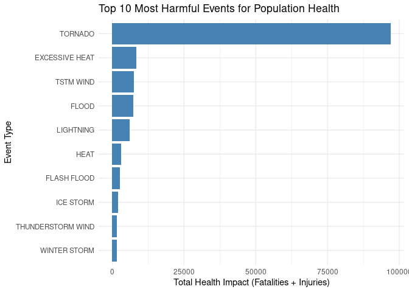
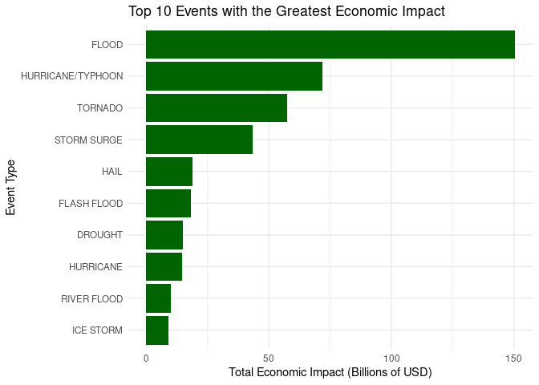

## Synopsis

This report analyzes the NOAA storm database (1950-2011) to identify which 
weather events are most harmful to public health and which have the greatest economic 
consequences. The analysis begins by loading the original compressed file and transforming
 the economic damage variables (PROPDMG and CROPDMG) into numeric values. Total health impacts
  (sum of fatalities and injuries) and economic impacts (sum of property and crop damage) are
   calculated for each event type (EVTYPE). Results are presented using tables and plots, showing 
   that tornadoes are the most harmful event for health, while floods cause the greatest economic 
   impact. These findings can help prioritize resources for disaster preparedness.

## Data Processing

### Loading libraries and downloading data


``` r
# Load required libraries
library(dplyr)
library(ggplot2)

# Define URL and destination file
fileUrl <- "https://d396qusza40orc.cloudfront.net/repdata%2Fdata%2FStormData.csv.bz2"
destFile <- "repdata_data_StormData.csv.bz2"

# Download if not exists
if (!file.exists(destFile)) {
  download.file(fileUrl, destfile = destFile, method = "auto", mode = "wb")
}

# Read data
storm_data <- read.csv(destFile, stringsAsFactors = FALSE)

# Explore structure
dim(storm_data)
```

```
## [1] 902297     37
```

``` r
names(storm_data)
```

```
##  [1] "STATE__"    "BGN_DATE"   "BGN_TIME"   "TIME_ZONE"  "COUNTY"    
##  [6] "COUNTYNAME" "STATE"      "EVTYPE"     "BGN_RANGE"  "BGN_AZI"   
## [11] "BGN_LOCATI" "END_DATE"   "END_TIME"   "COUNTY_END" "COUNTYENDN"
## [16] "END_RANGE"  "END_AZI"    "END_LOCATI" "LENGTH"     "WIDTH"     
## [21] "F"          "MAG"        "FATALITIES" "INJURIES"   "PROPDMG"   
## [26] "PROPDMGEXP" "CROPDMG"    "CROPDMGEXP" "WFO"        "STATEOFFIC"
## [31] "ZONENAMES"  "LATITUDE"   "LONGITUDE"  "LATITUDE_E" "LONGITUDE_"
## [36] "REMARKS"    "REFNUM"
```

``` r
head(storm_data, 3)
```

```
##   STATE__          BGN_DATE BGN_TIME TIME_ZONE COUNTY COUNTYNAME STATE  EVTYPE
## 1       1 4/18/1950 0:00:00     0130       CST     97     MOBILE    AL TORNADO
## 2       1 4/18/1950 0:00:00     0145       CST      3    BALDWIN    AL TORNADO
## 3       1 2/20/1951 0:00:00     1600       CST     57    FAYETTE    AL TORNADO
##   BGN_RANGE BGN_AZI BGN_LOCATI END_DATE END_TIME COUNTY_END COUNTYENDN
## 1         0                                               0         NA
## 2         0                                               0         NA
## 3         0                                               0         NA
##   END_RANGE END_AZI END_LOCATI LENGTH WIDTH F MAG FATALITIES INJURIES PROPDMG
## 1         0                      14.0   100 3   0          0       15    25.0
## 2         0                       2.0   150 2   0          0        0     2.5
## 3         0                       0.1   123 2   0          0        2    25.0
##   PROPDMGEXP CROPDMG CROPDMGEXP WFO STATEOFFIC ZONENAMES LATITUDE LONGITUDE
## 1          K       0                                         3040      8812
## 2          K       0                                         3042      8755
## 3          K       0                                         3340      8742
##   LATITUDE_E LONGITUDE_ REMARKS REFNUM
## 1       3051       8806              1
## 2          0          0              2
## 3          0          0              3
```

### Data transformation

The database uses single-letter codes for damage magnitudes (e.g., "K" for
 thousands, "M" for millions, "B" for billions). We transform these columns 
 into numeric values to calculate total damages in dollars.


``` r
# Function to convert exponent codes to numeric multipliers
exp_to_multiplier <- function(exp_code) {
  exp_code <- toupper(trimws(as.character(exp_code)))
  mult <- rep(1, length(exp_code))
  mult[exp_code == "H"] <- 1e2
  mult[exp_code == "K"] <- 1e3
  mult[exp_code == "M"] <- 1e6
  mult[exp_code == "B"] <- 1e9
  is_digit <- grepl("^[0-9]$", exp_code)
  mult[is_digit] <- 10^as.numeric(exp_code[is_digit])
  return(mult)
}

# Create clean dataframe
storm_clean <- storm_data %>%
  transmute(
    EVTYPE = toupper(trimws(EVTYPE)),
    FATALITIES = as.numeric(FATALITIES),
    INJURIES = as.numeric(INJURIES),
    PROPDMG = as.numeric(PROPDMG),
    PROPDMGEXP = as.character(PROPDMGEXP),
    CROPDMG = as.numeric(CROPDMG),
    CROPDMGEXP = as.character(CROPDMGEXP)
  ) %>%
  mutate(
    health_impact = FATALITIES + INJURIES,
    property_damage = PROPDMG * exp_to_multiplier(PROPDMGEXP),
    crop_damage = CROPDMG * exp_to_multiplier(CROPDMGEXP),
    economic_impact = property_damage + crop_damage
  )

str(storm_clean)
```

```
## 'data.frame':	902297 obs. of  11 variables:
##  $ EVTYPE         : chr  "TORNADO" "TORNADO" "TORNADO" "TORNADO" ...
##  $ FATALITIES     : num  0 0 0 0 0 0 0 0 1 0 ...
##  $ INJURIES       : num  15 0 2 2 2 6 1 0 14 0 ...
##  $ PROPDMG        : num  25 2.5 25 2.5 2.5 2.5 2.5 2.5 25 25 ...
##  $ PROPDMGEXP     : chr  "K" "K" "K" "K" ...
##  $ CROPDMG        : num  0 0 0 0 0 0 0 0 0 0 ...
##  $ CROPDMGEXP     : chr  "" "" "" "" ...
##  $ health_impact  : num  15 0 2 2 2 6 1 0 15 0 ...
##  $ property_damage: num  25000 2500 25000 2500 2500 2500 2500 2500 25000 25000 ...
##  $ crop_damage    : num  0 0 0 0 0 0 0 0 0 0 ...
##  $ economic_impact: num  25000 2500 25000 2500 2500 2500 2500 2500 25000 25000 ...
```

## Results

### 1. Which types of events are most harmful to population health?


``` r
health_impact <- storm_clean %>%
  group_by(EVTYPE) %>%
  summarise(
    total_fatalities = sum(FATALITIES, na.rm = TRUE),
    total_injuries = sum(INJURIES, na.rm = TRUE),
    total_health_impact = sum(health_impact, na.rm = TRUE)
  ) %>%
  arrange(desc(total_health_impact))

head(health_impact, 10)
```

```
## # A tibble: 10 × 4
##    EVTYPE            total_fatalities total_injuries total_health_impact
##    <chr>                        <dbl>          <dbl>               <dbl>
##  1 TORNADO                       5633          91346               96979
##  2 EXCESSIVE HEAT                1903           6525                8428
##  3 TSTM WIND                      504           6957                7461
##  4 FLOOD                          470           6789                7259
##  5 LIGHTNING                      816           5230                6046
##  6 HEAT                           937           2100                3037
##  7 FLASH FLOOD                    978           1777                2755
##  8 ICE STORM                       89           1975                2064
##  9 THUNDERSTORM WIND              133           1488                1621
## 10 WINTER STORM                   206           1321                1527
```

**Figure 1: Top 10 most harmful events for health.**


``` r
top_health <- head(health_impact, 10)

ggplot(top_health, aes(x = reorder(EVTYPE, total_health_impact),
                       y = total_health_impact)) +
  geom_bar(stat = "identity", fill = "steelblue") +
  coord_flip() +
  labs(
    title = "Top 10 Most Harmful Events for Population Health",
    x = "Event Type",
    y = "Total Health Impact (Fatalities + Injuries)"
  ) +
  theme_minimal()
```



### 2. Which types of events have the greatest economic consequences?


``` r
economic_impact <- storm_clean %>%
  group_by(EVTYPE) %>%
  summarise(
    total_property_damage = sum(property_damage, na.rm = TRUE),
    total_crop_damage = sum(crop_damage, na.rm = TRUE),
    total_economic_impact = sum(economic_impact, na.rm = TRUE)
  ) %>%
  arrange(desc(total_economic_impact))

head(economic_impact, 10)
```

```
## # A tibble: 10 × 4
##    EVTYPE          total_property_damage total_crop_damage total_economic_impact
##    <chr>                           <dbl>             <dbl>                 <dbl>
##  1 FLOOD                   144657709807         5661968450         150319678257 
##  2 HURRICANE/TYPH…          69305840000         2607872800          71913712800 
##  3 TORNADO                  56947380676.         414953270          57362333946.
##  4 STORM SURGE              43323536000               5000          43323541000 
##  5 HAIL                     15735267513.        3025954473          18761221986.
##  6 FLASH FLOOD              16822723978.        1421317100          18244041078.
##  7 DROUGHT                   1046106000        13972566000          15018672000 
##  8 HURRICANE                11868319010         2741910000          14610229010 
##  9 RIVER FLOOD               5118945500         5029459000          10148404500 
## 10 ICE STORM                 3944927860         5022113500           8967041360
```

**Figure 2: Top 10 events with the greatest economic impact.**


``` r
top_economic <- head(economic_impact, 10)

ggplot(top_economic, aes(x = reorder(EVTYPE, total_economic_impact),
                         y = total_economic_impact / 1e9)) +
  geom_bar(stat = "identity", fill = "darkgreen") +
  coord_flip() +
  labs(
    title = "Top 10 Events with the Greatest Economic Impact",
    x = "Event Type",
    y = "Total Economic Impact (Billions of USD)"
  ) +
  theme_minimal()
```



## Conclusion

The analysis of the NOAA database shows that tornadoes are by far the most harmful 
event for public health in the United States, causing thousands of fatalities and
 injuries between 1950 and 2011. Regarding economic impact, floods top the list, 
 followed by hurricanes and severe storms. These results suggest that preparedness
  and response resources should prioritize early tornado warnings and flood risk management.
